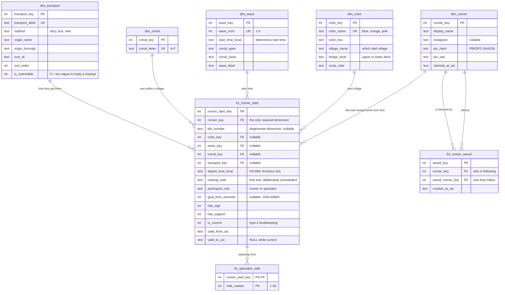

# Data model

A Kimball-style star schema in SQLite (Cloudflare D1), built around one question:
**given where everybody starts the New York City Marathon, who will physically be near
whom?**

Every number on this page is from the live database after the race. The roster is
anonymised — see [After the race](#after-the-race) — but every count, relationship and
distribution is real.

- [ERD](#erd)
- [Grain](#grain-the-first-thing-to-establish)
- [Dimensions](#dimensions) · [Facts](#facts) · [Operational](#operational)
- [The view layer](#the-view-layer)
- [Four decisions worth defending](#four-decisions-worth-defending)
- [Querying it yourself](#querying-it-yourself)

---

## ERD



Four conformed dimensions, one degenerate dimension riding on the fact, two factless fact
tables and one child table. `fct_runner_saved` is a **self-referencing bridge** —
`dim_runner` to itself — which is why `dim_runner` has two lines into it.

| Table | Rows | Kind |
|---|---:|---|
| `dim_color` | 3 | dimension (reference) |
| `dim_wave` | 5 | dimension (reference) |
| `dim_corral` | 6 | dimension (reference) |
| `dim_transport` | 7 | dimension (reference) |
| `dim_runner` | 73 | dimension (people) |
| `fct_runner_start` | 98 | fact, insert-only |
| `fct_runner_saved` | 50 | fact / bridge |
| `fct_spectator_mile` | 3 | child of the fact |
| `auth_throttle` | 0 | operational, outside the model |

---

## Grain: the first thing to establish

> **`fct_runner_start`** — one row per **version** of one person's start assignment.
> **`fct_runner_saved`** — one row per **directed follow**, from one person to another.
> **`fct_spectator_mile`** — one row per **mile a spectator plans to watch from**.

That first grain is why there are 98 rows for 69 live assignments. The table is
**insert-only**: editing your wave does not update your row, it closes the old one
(`is_current = 0`, `valid_to_utc` stamped) and inserts a new one.

In this dataset that produced **29 superseded rows from 18 people** who came back and
changed something. NYRR lets you move to a later wave, so this happens for real — and the
history is the interesting part, not an accident to be cleaned up.

A partial unique index enforces that only one row per person can be live at a time:

```sql
CREATE UNIQUE INDEX idx_fct_current_runner
    ON fct_runner_start (runner_key) WHERE is_current = 1;
```

Partial, not total — the whole point is that a person has many historical rows and exactly
one current one. The same trick guards bib numbers.

---

## Dimensions

### `dim_color` — 3 rows

The start village. For 2026 the colours are blue, orange and pink; green was retired.
Carries `village_name` and `bridge_level` (blue and orange on the Verrazzano's upper deck,
pink on the lower), which are display-only — no logic depends on them.

### `dim_wave` — 5 rows

**Start time lives here, not on the fact**, because NYRR fully determines your start time
from your wave. Storing it on `fct_runner_start` would be storing a derivable attribute
and inviting the two to disagree. The entry form derives and displays it rather than
asking.

### `dim_corral` — 6 rows

Letters A–F. **A corral letter only means something inside a colour** — Orange C and Blue
C are different pens in different villages — which is why every corral comparison in the
matching logic is built on colour *and* wave, never the letter alone.

### `dim_transport` — 7 rows

How you reach Staten Island: ferry, the Verrazzano buses, charity coaches, your own car.

The column worth noting is **`is_matchable`**. "Bus — not sure which", "Still deciding"
and "Have my own transportation" are all legitimate answers and none of them implies a
meetup: two people who both said "a bus" are not necessarily on the same bus, and two
people driving themselves are definitively in separate cars. Those rows are flagged `0`
and excluded from the transport-based matching, so the app never invents a match it cannot
justify.

### `dim_runner` — 73 rows

People. Deliberately thin: a display name, an optional Instagram handle, and PIN material.

`first_name` and `last_name` exist from an early import path and were never populated —
the app only ever asked for one name. They survive as a reminder that a column you add
"just in case" stays empty and still has to be explained to everyone who reads the schema
afterwards.

---

## Facts

### `fct_runner_start` — 98 rows, 69 current

The core fact. **Factless**: there is no additive measure. It records that a runner *is
assigned* to a colour, wave, corral and transport plan. `COUNT(*)` is the only measure it
offers, which is exactly Kimball's coverage/event pattern.

Every dimension except `runner_key` is **nullable**, on purpose. People sign up before
NYRR assigns bibs and before they have decided how they are travelling; a schema that
demanded everything would have made people invent data or give up. 63 of 69 profiles ended
up complete, and the 6 that did not are honest rather than fabricated.

**`bib_number` is a degenerate dimension** — a real-world identifier with no attributes of
its own worth a table, so it rides on the fact. It is nullable and guarded:

```sql
CHECK (bib_number IS NULL OR length(trim(bib_number)) > 0)
```

An unknown bib must be `NULL` and never `''`, because empty strings are *not* distinct to
a unique index: three blank bibs would collide on `idx_fct_current_bib`, where three
`NULL` bibs coexist happily.

The type-2 bookkeeping is enforced rather than trusted:

```sql
CHECK ((is_current = 1 AND valid_to_utc IS NULL)
    OR (is_current = 0 AND valid_to_utc IS NOT NULL))
```

A live row must be open-ended and a superseded row must be closed. There is no way to
write a half-closed row.

### `fct_runner_saved` — 50 rows

One directed edge per follow. Also factless, also a **many-to-many bridge** from
`dim_runner` back to itself.

Unlike the start table this one is **not** insert-only. Unfollowing someone is a
correction, not history — keeping it would turn the dataset into a record of who changed
their mind about whom, which is nobody's business and was never the point.

```sql
UNIQUE (runner_key, saved_runner_key),   -- following twice is a no-op, not two rows
CHECK  (runner_key <> saved_runner_key)  -- you are already going to find yourself
```

### `fct_spectator_mile` — 3 rows

A child table, keyed on `runner_start_key` rather than `runner_key`, so a spectator's
miles are **versioned along with the rest of their assignment**: edit your miles and the
old set stays attached to the superseded row, exactly like a wave change.

A table rather than a column because spectators move along the course — someone watching
at mile 18 and mile 23 needs two rows, and you cannot filter on a comma-separated string.

---

## Operational

### `auth_throttle` — 0 rows

Rate-limit counters for sign-in and group-password attempts. **Outside the dimensional
model on purpose**: it is operational state, it holds client IP addresses, and it is
excluded from every export by name. The snapshot tool refuses to run if it encounters a
table it has not been told to keep or drop.

---

## The view layer

**The API never touches a base table.** Nine views carry the model, and they are the
reason no route anywhere writes `WHERE is_current = 1`.

| View | Rows | What it answers |
|---|---:|---|
| `v_runner_start` | 69 | The roster. Current rows only, with every dimension joined and `is_complete` derived. Everything else builds on this. |
| `v_saved_overlap` | 49 | For each person you follow, *how* do you overlap — same corral, wave, village, vehicle, departure slot? |
| `v_roster_gaps` | 8 | Who is still missing information, described per role. |
| `v_unclaimed_runner` | 73 | Rows nobody has set a PIN on — the "someone already added me" picker. |
| `v_start_assignment` | 90 | Every valid colour × wave × corral combination, a `CROSS JOIN` used to populate the form. |
| `v_meetup_corral` | 14 | Groups of 2+ in the same pen. |
| `v_meetup_wave` | 14 | Groups of 2+ in the same village at the same time. |
| `v_meetup_transport` | 15 | Groups of 2+ on the same vehicle at the same departure slot. |
| `v_meetup_vehicle` | 3 | Same vehicle, times unknown — the weakest tier, kept separate so it never masquerades as a real match. |

### A worked example of why grain matters

`fct_runner_saved` has **50** rows. `v_saved_overlap` returns **49**.

The difference is one real person who followed someone, and that someone later removed
themselves from the roster. The view inner-joins `v_runner_start` twice — once for you,
once for them — and `v_runner_start` only contains *current* rows, so a follow pointing at
somebody with no live assignment drops out.

That is correct behaviour, not a bug: there is no overlap to compute against a person who
is not racing. But it is exactly the kind of silent row loss that makes "what is the grain
of this view?" the first question worth asking of anything.

The app handles the dropped edge separately and labels it `not on the roster`, so the
person still sees who they followed.

### NULL-safety is explicit everywhere

Every comparison in `v_saved_overlap` is NULL-guarded:

```sql
CASE WHEN me.color_key IS NOT NULL AND them.color_key IS NOT NULL
      AND me.color_key = them.color_key
     THEN 1 ELSE 0 END AS same_village
```

`NULL = NULL` is `NULL`, not true — but the guards are there for the *human* reading, not
the engine. Two people who have both left their corral blank must not read as sharing one,
and the version of this code that omitted the checks was wrong in a way that looked right.

---

## Four decisions worth defending

**1. Start time belongs to the wave, not the fact.** It is fully determined by
`wave_key`. Storing it twice invites the two copies to disagree.

**2. The fact table is insert-only.** An edit supersedes rather than updates, so the data
remembers who moved wave and when. This is what makes
[`sql/04_assignment_history.sql`](../sql/04_assignment_history.sql) possible at all.

**3. `is_matchable` lives on the dimension, not in application code.** Whether "Still
deciding" counts as a shared ride is a property of that transport option, so it belongs
next to it. Correcting it is an `UPDATE`, not a deploy.

**4. Both fact tables are factless, and that was the point.** Neither has an additive
measure. If you are evaluating this as a modelling exercise, that is the thing to look at:
a coverage fact (`is assigned to`) and an event/bridge fact (`wants to find`), with
`COUNT(*)` as the only measure either offers.

---

## After the race

Migration `0010` anonymised the live database in place: names became stable aliases
(`Runner 017`), bib numbers became synthetic values in a range no real bib occupies,
Instagram handles and free-text notes were removed, and all PIN material was cleared.

**Only identity fields were touched.** Every timestamp, every superseded row, every follow
edge, the two accidental duplicate accounts and the four people who removed themselves are
exactly as they were. The structure and the distributions on this page are the real ones.

One visible artifact: `v_unclaimed_runner` now returns all 73 rows, because it defines
"unclaimed" as `pin_hash IS NULL` and every PIN hash is gone. That is why the live
deployment runs in a read-only demo mode where nothing can be claimed.

---

## Querying it yourself

The anonymised dataset loads into SQLite, DuckDB or Postgres with no Cloudflare account:

```bash
sqlite3 nycm.db < snapshots/nycm2026-anon.sql
```

It includes all nine views. Ad-hoc queries live in [`sql/`](../sql):

| | |
|---|---|
| [`01_roster.sql`](../sql/01_roster.sql) | The roster as the browse page sees it |
| [`02_meetups.sql`](../sql/02_meetups.sql) | Who will physically run into whom |
| [`03_wave_spread.sql`](../sql/03_wave_spread.sql) | How the group spreads across the start — the factless fact table earning its keep |
| [`04_assignment_history.sql`](../sql/04_assignment_history.sql) | The payoff for insert-only: who changed assignment, and when |
| [`05_start_assignment_lookup.sql`](../sql/05_start_assignment_lookup.sql) | "What time does Orange Wave 3 Corral B go off?" |

A good first query, and the one that shows the grain most clearly:

```sql
SELECT display_name,
       COUNT(*)                                  AS versions,
       MIN(valid_from_utc)                       AS first_entered,
       MAX(CASE WHEN is_current = 1 THEN 'yes' END) AS still_racing
  FROM fct_runner_start f
  JOIN dim_runner r USING (runner_key)
 GROUP BY runner_key
HAVING COUNT(*) > 1
 ORDER BY versions DESC;
```
